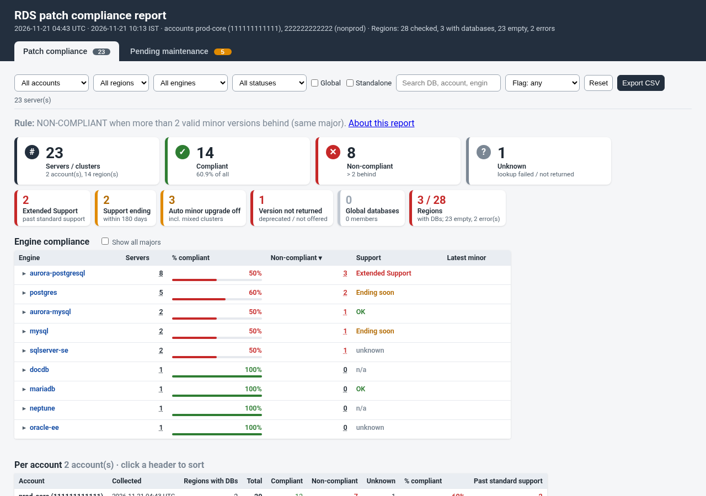

# rds-patch-compliance

`rds_patch_compliance_report.sh` (v1.8.1) is a **read-only** patch compliance report for AWS databases. For every Aurora cluster, RDS instance, Multi-AZ DB cluster, DocumentDB cluster and Neptune cluster it shows how many **minor versions** the database is behind, and marks it **COMPLIANT** or **NON-COMPLIANT**. Versions behind are the valid minor upgrade targets RDS returns for the current version. It also flags majors past (or near) the end of standard support, auto minor upgrade switched off, pending maintenance and deprecated versions. It works across several accounts and regions. Output formats are text, CSV, JSON and a single-file HTML report.

A second script, `rds_patch_compliance_summary.sh`, shows only the high-level picture and the NON-COMPLIANT servers. Both scripts read the same settings file.

**Settings live in one file.** [`rds_patch_compliance_report.conf`](rds_patch_compliance_report.conf) (next to the scripts) holds every value, each with a short comment. It is loaded automatically; just run `./rds_patch_compliance_report.sh`. A command line option overrides one value for that run. See [The settings file](REFERENCE.md#the-settings-file).



Sample outputs (fake accounts `111111111111` and `222222222222`) are in [samples/](samples/).

## Requirements

- Bash 4.4+, jq 1.6+ and AWS CLI v2 (2.15+ recommended). All are present in CloudShell. Git Bash with `jq.exe` also works for merging offline.
- Read-only IAM permissions: `rds:DescribeDBClusters`, `rds:DescribeDBInstances`, `rds:DescribePendingMaintenanceActions`, `rds:DescribeDBEngineVersions`, `rds:DescribeDBMajorEngineVersions`, `rds:DescribeGlobalClusters`, `ec2:DescribeRegions`, and optionally `iam:ListAccountAliases` (account name). `sts:GetCallerIdentity` needs no permission. See [Permissions](REFERENCE.md#permissions-read-only).

## Quick start (CloudShell)

```bash
cd ~ && curl -fsSLO https://github.com/manideepgrandhi/rds-patch-compliance/releases/latest/download/rds-patch-compliance.zip && curl -fsSLO https://github.com/manideepgrandhi/rds-patch-compliance/releases/latest/download/rds-patch-compliance.zip.sha256
sha256sum -c rds-patch-compliance.zip.sha256 && unzip -oq rds-patch-compliance.zip && cd ~/rds-patch-compliance   # must print "OK"
vi rds_patch_compliance_report.conf          # profiles, regions, alert_emails ...
./rds_patch_compliance_report.sh             # csv, html and txt into ./reports
```

`sha256sum -c` must print `rds-patch-compliance.zip: OK`. If it reports `FAILED`, the `&&` chain stops before `unzip`; delete the zip and do not run it.

A quick look on the screen: `./rds_patch_compliance_report.sh -r us-east-1 -F text -o '' -l ''`. More commands with sample output: [EXAMPLES.md](EXAMPLES.md).

You can also clone the repo: `git clone https://github.com/manideepgrandhi/rds-patch-compliance.git ~/rds-patch-compliance` and update later with `git pull --ff-only`.

## What the statuses mean

| Status | Meaning |
|---|---|
| **COMPLIANT** | The server has 0, 1 or 2 valid minor upgrade targets left (`<= --max-behind`, default 2). |
| **NON-COMPLIANT** | It has 3 or more valid minor targets. |
| **UNKNOWN** | The version lookup failed, or RDS no longer returns the current version (deprecated or not offered in that region). |

The count uses only `ValidUpgradeTarget` entries with `IsMajorVersionUpgrade=false` in the server's own region. Oracle targets also have to be on the same patch line, unless you turn that off. Details: [The compliance rule](REFERENCE.md#the-compliance-rule) and [Oracle versions](REFERENCE.md#oracle-versions-patch-lines).

Other flags (end of standard support, auto minor upgrade off, pending maintenance) are shown but do not change the status. See [Other flags](REFERENCE.md#other-flags).

**Engines:** Aurora PostgreSQL / MySQL and Multi-AZ, DocumentDB and Neptune clusters are judged per cluster. Standalone RDS (PostgreSQL, MySQL, MariaDB, SQL Server, Oracle) is judged per instance. Cluster members are not separate rows. Other engines (for example RDS Custom, Db2) are ignored. The full list is in [Engines](REFERENCE.md#engines-and-what-is-judged).

## The two scripts

- **Full report** (`rds_patch_compliance_report.sh`): every server, every format, the HTML report with a Patch compliance tab and a Pending maintenance tab.
- **Summary** (`rds_patch_compliance_summary.sh`): the totals, the per-region and per-engine picture, and only the NON-COMPLIANT (and UNKNOWN) servers. It uses the same conf and the same counting.

```bash
./rds_patch_compliance_summary.sh -P prod,nonprod -r us-east-1,ap-south-1              # txt to the screen
./rds_patch_compliance_summary.sh -P prod --all-regions -F txt,html,csv -o ~/compliance
```

To cover several accounts: run with `--save-data` in CloudShell in each account, download the JSON files, then merge them offline (`--merge`, zero AWS calls). The same files work with either script. Walk-through with sample output: [EXAMPLES.md](EXAMPLES.md#summary-only-several-accounts-save-in-cloudshell-merge-in-git-bash-summary-v130). The merge rules are in [Several accounts](REFERENCE.md#several-accounts).

## Most-used settings

Every setting is in [rds_patch_compliance_report.conf](rds_patch_compliance_report.conf) (next to the scripts). Any of them can be overridden for one run with a command-line option, for example `--max-behind 1` or `-r us-east-1`.

| Setting | Shipped | Meaning |
|---|---|---|
| `profiles` | empty | AWS CLI profile(s), one per account. Empty = the current login |
| `all_regions` / `regions` | `yes` / empty | Scan every enabled region (probed first), or only `regions` |
| `max_behind` | `2` | NON-COMPLIANT when the server is more than this many valid minor targets behind |
| `warn_days` | `180` | "Support ends soon" window, in days |
| `formats` / `output_dir` | `csv,html,txt` / `./reports` | Report formats and where they go |
| `alert_emails` | empty | Who gets an e-mail summary. Empty = no e-mail |
| `attach_html` / `attach_csv` | `yes` / `yes` | Attach the HTML report and the per-server CSV (sendmail) |
| `attach_prefix` | `patch_compliance` | Short attachment names: `NAME_YYYY-MM-DD.html` / `.csv` |
| `alert_on` | `noncompliant` | `noncompliant` = send only when a server is NON-COMPLIANT or an AWS call failed; `always` = every run |

All settings, with allowed values: [The settings file](REFERENCE.md#the-settings-file), or the comments in the conf itself.

## Exit codes

| Code | Meaning |
|---|---|
| 0 | Report produced (also when servers are non-compliant) |
| 1 | Usage or a missing conf setting |
| 2 | Pre-check failed (aws, jq or credentials) |
| 3 | Bad `--merge` input |
| 4 | Output error |
| 5 | NON-COMPLIANT found, with `--fail-on-noncompliant` |
| 130 | Interrupted |

A region that was denied, or a failed discovery probe, is listed under ERRORS in the report and does not change the exit code.

## More docs

- [REFERENCE.md](REFERENCE.md): the full reference. Engines, the rule, Oracle patch lines, the report, exceptions, options, IAM, alerts, the settings file, tests and version notes.
- [EXAMPLES.md](EXAMPLES.md): usage examples with sample output.
- [docs/ARCHITECTURE.md](docs/ARCHITECTURE.md): what happens when you run the scripts, a flow diagram, and the use of every file and function.
- [CHANGELOG.md](CHANGELOG.md): what changed in each release. Also on the [What's new](https://manideepgrandhi.github.io/rds-patch-compliance/) page.
- [compliance_exceptions.conf.example](compliance_exceptions.conf.example): template for marking approved exceptions (see [Compliance exceptions](REFERENCE.md#compliance-exceptions-v160)).
- [samples/](samples/): checked-in example reports from the test mock.

Sibling tools: [RDS_Pending_Maintenance](https://github.com/manideepgrandhi/DBA/tree/main/AWS/RDS_Pending_Maintenance) shows *what maintenance is pending and when*; [RDS_Patch_Runner](https://github.com/manideepgrandhi/DBA/tree/main/AWS/RDS_Patch_Runner) *applies* it to one cluster safely. This tool answers *how far behind are we on minor versions*.
