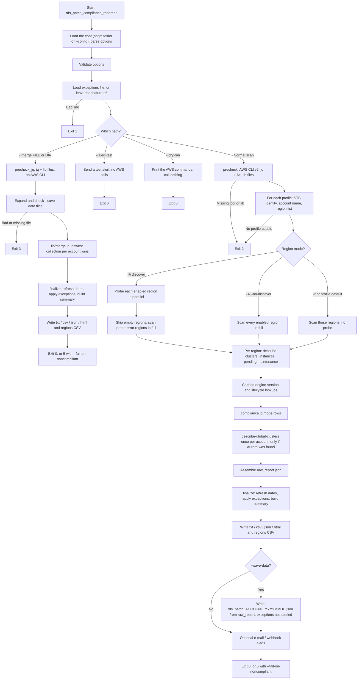
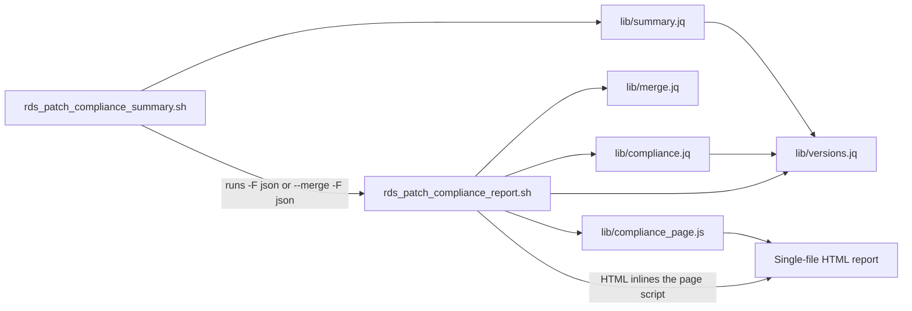

# Architecture: what happens when you run the patch compliance scripts

This document is for DBA team members who need to explain or maintain the tools in this repo. It describes the code on the `feature/exceptions` branch (script version **1.6.0**), including compliance exceptions. Every behaviour below is taken from the scripts and `lib/` files; nothing here is invented.

The script you run is `rds_patch_compliance_report.sh`, not `rds-patch-compliance.sh`. A shorter companion, `rds_patch_compliance_summary.sh`, is covered at the end of the overview.

---

## 1. Overview

`rds_patch_compliance_report.sh` is a **read-only** report. For every in-scope Aurora cluster, Multi-AZ DB cluster, DocumentDB cluster, Neptune cluster and standalone RDS instance, across the accounts (AWS CLI profiles) and regions you give it, it answers: **how many valid minor upgrade targets does RDS list for the current version, and is that within the allowed lag?**

The rule (in `lib/compliance.jq`) is:

- `versions_behind` = the number of valid **minor** upgrade targets RDS returns for that engine and version in that region (`describe-db-engine-versions --engine E --engine-version V`, then `ValidUpgradeTarget[]` with `IsMajorVersionUpgrade=false`, same major line; Oracle also stays on the same patch line unless `--oracle-any-patch-line`).
- **COMPLIANT** when `versions_behind` is at most `--max-behind` (default 2).
- **NON-COMPLIANT** when it is higher (with the default, 3 or more).
- **UNKNOWN** when the lookup failed, or RDS did not return the current version (deprecated / not offered in that region).

A cluster is judged once; its member instances are listed on the cluster row, not as rows of their own. Standalone instances (including read replicas that are not in a cluster) are their own rows. Other engines (for example RDS Custom or Db2) are ignored.

The script also records support end dates, auto minor upgrade, pending maintenance, and Aurora global database membership. Those are flags and extra columns; they do not change COMPLIANT / NON-COMPLIANT / UNKNOWN.

Output formats are text, CSV, JSON and a single-file HTML report. Several formats at once need `-o DIR`. The work is split: the shell script talks to AWS and writes files; `lib/compliance.jq` (with `lib/versions.jq`) evaluates and renders; `lib/compliance_page.js` is inlined into the HTML for filters and CSV export. There are **no writes** to AWS: only `describe-*`, `sts get-caller-identity`, optional `iam list-account-aliases` and (with `-A`) `ec2 describe-regions`.

### The summary script

`rds_patch_compliance_summary.sh` does not scan AWS itself. It reads the same `rds_patch_compliance_report.conf` as the full report (own loader, same required keys), writes a temporary copy of it with the output and alert settings switched off (`formats = json`, no output dir, no alerts, no fail exit), and runs `rds_patch_compliance_report.sh --config <that copy>` (or `--merge ...`) to get the finalized JSON. All counting, including exceptions if they were applied by the full report, comes from there. `lib/summary.jq` only renders a short picture: totals, the NON-COMPLIANT list, UNKNOWN reasons, and optional txt / html / csv outputs; the summary script sends its own alerts, with the same HTML e-mail (`lib/alert_email.jq`).

It accepts `--exceptions FILE` (v1.6.0) and passes it through to the full report, including with `--merge`. If you do not pass the flag and `compliance_exceptions.conf` sits next to the scripts, the full report still loads it automatically when the summary script calls it. The summary script reports its own version as **1.6.0**.

---

## 2. What happens when you run it

Numbered steps for `./rds_patch_compliance_report.sh ...`. Several steps are skipped on the `--merge`, `--dry-run` or `--alert-test` paths; those branches are called out.

### 1. Load the conf file and parse options

`parse_args` first looks for `--config FILE` on the command line. With none, the script loads `rds_patch_compliance_report.conf` from its own folder. The file is parsed line by line, never sourced. Supported keys are `key = value`; every setting must be present (`REQUIRED_KEYS`), and a missing key stops the run with exit 1, naming the key(s). The script has no built-in values: the conf is the single place for them. `111111111111 = prod-payments` lines are account display names. Unknown keys, and any credential key (`aws_access_key_id`, `aws_secret_access_key`, `aws_session_token`, `secret`, `password`), stop the run with exit 1. Booleans are strict yes / no. `validate` then logs which conf was used (`Settings: ... loaded automatically from the script folder` or `from --config`).

Command-line options are then applied and **win** over the conf, one value at a time. The first use of a list option such as `-P` or `-r` replaces the conf list; later uses append. `-r` switches off `all_regions`; `-A` clears the conf `regions`. `--merge` ignores the conf's scope keys (profiles, regions, all_regions, engines, identifiers); giving them on the command line is an error.

### 2. Validate, then load exceptions

`validate` checks formats, paths, numbers, region and profile names, time zone, and alert settings. Bad input exits 1. Missing `jq` here exits 2.

It then calls `load_exceptions`, **before any AWS call**, so a bad exceptions line fails immediately:

- If you passed `--exceptions FILE` (or config `exceptions = FILE`), that file must exist and be readable.
- If you did not, the script looks for `compliance_exceptions.conf` next to the script. If that file is absent, exceptions are off (`EXC_JSON=null`) and the reports are unchanged.
- Format: `account_id | identifier | scope | expires | reason` (all five required). `#` comments and blank lines are ignored. Scope is `patch`, `backup` or `patch,backup`. Identifier is exact (letters, digits, hyphens; no wildcards). Expires is a real calendar date `YYYY-MM-DD` (UTC, last valid day). A duplicate account + identifier + scope, or any other bad line, exits 1 naming `file:line`.

This tool only uses entries whose scope includes `patch`. A `backup`-only line is accepted (the file is shared with the backup and compliance-report tools) and then ignored here.

### 3. Choose a path

`main` then takes one of these paths:

| Path | What happens |
|---|---|
| `--merge FILE\|DIR...` | Offline. `merge_main` runs, writes outputs, and exits. Zero AWS calls; AWS CLI is not required. |
| `--alert-test` | Sends a test e-mail / webhook and exits 0. No AWS calls. Needs `--alert-email` or `--alert-webhook`. |
| `--dry-run` | Prints the exact read-only AWS commands a real run would issue, and exits 0. |
| Normal scan | Continues with the pre-check and collection below. |

`--merge` cannot be combined with `-P` / `-r` / `-A`, with `-e` / `-i`, or with `--dry-run`, `--save-data` or `--alert-test`.

### 4. Pre-check (scan path)

`precheck` requires AWS CLI v2, jq 1.6+, `lib/compliance.jq` and `lib/compliance_page.js`. Failure exits 2. A work directory is created under `${TMPDIR:-/tmp}/rds_pcr.XXXXXX` (removed on exit unless `--keep-workdir`). `errors.jsonl` is created empty.

The `--merge` path uses `precheck_jq` instead (jq and the three lib files, including `lib/merge.jq`; no AWS CLI).

### 5. Discover regions and collect per account

For each `-P` profile (or the default credential chain if you gave none):

1. **Identity.** `sts get-caller-identity` in the first region (an explicit `-r`, else `AWS_REGION` / `AWS_DEFAULT_REGION`, else `aws configure get region`, else `us-east-1` when `-A` is set). Invalid credentials are recorded and that profile is skipped. If every profile fails, the run exits 2.
2. **Account name.** Config name if present, otherwise a soft `iam list-account-aliases` (optional; denial is silent).
3. **Region list.**
   - `-r us-east-1,ap-south-1`: those regions, scanned in full. No probe.
   - `-A` (default discover): `ec2 describe-regions`, then a discovery probe of every enabled region (`discover_regions` / `probe_region`). Two one-page calls per region, at most `--probe-parallel` (default 8) at a time: `rds describe-db-instances --max-records 20 --query length(DBInstances) --no-paginate` and the same for clusters. Regions the probe finds empty are skipped. A probe that fails (AccessDenied, SCP, timeout) is recorded as an error and that region is **still scanned in full**.
   - `-A --no-discover`: every enabled region is scanned in full, no probe.
4. **Full scan of each kept region** (`collect_region`), always these three RDS calls:
   1. `rds describe-db-clusters`
   2. `rds describe-db-instances`
   3. `rds describe-pending-maintenance-actions` (if this one fails, pending actions are shown as 0 and the scan continues)
   If clusters or instances fail, the error is recorded and that region is left; the other regions continue.
5. **Engine version and lifecycle lookups** (`collect_versions`), after the region's engines and versions are known, and after `-e` has been applied:
   - One `rds|docdb|neptune describe-db-engine-versions --engine E --engine-version V` per distinct engine + version + region. Results are cached under `$WORK/ev/<region>/` and reused by later profiles. Only that version's `ValidUpgradeTarget[]` is kept; the full version list is never read. A failed or missing lookup makes those servers **UNKNOWN** (a warning, not a hard AWS error).
   - One `rds describe-db-major-engine-versions --engine E` per RDS engine + region, also cached. DocumentDB and Neptune have no lifecycle API. If the CLI has no such command, support dates show `unknown` for the rest of the run.
6. **Build that region's rows** with `lib/compliance.jq` mode `rows` → `$dir/rows.json`.
7. **Aurora global databases** (`collect_globals`), once per account, only when an Aurora cluster was found: one `rds describe-global-clusters`. A failure is a warning, not counted as an AWS error; those clusters show global role `unknown`.

`--engine` and `--identifier` filters (shell globs, case-insensitive) are applied when the rows are built. A cluster also matches when a member name matches `-i`.

### 6. Build the report and apply exceptions

`build_report` concatenates every `rows.json`, the errors, account list, region status and global lookup into `raw_report.json`, then runs `lib/compliance.jq` mode `finalize`:

1. Attach account names and recompute support / maintenance days against the run clock (or merge time).
2. **If exceptions are on, apply them to every row** (`exc_apply`). This is the only place status is changed to COMPLIANT for an excepted server. `--save-data` is written from `raw_report.json` and is not affected.
3. Annotate Aurora global membership and attach pending actions on the global cluster ARN.
4. Build the summary (counts, %, per engine / region / account, global databases, exception counts). `--non-compliant-only` hides rows from the list; the summary still counts every row.

### 7. Write the outputs

`write_outputs` renders each `-F` format through `compliance.jq`. Without `-o`, a single format goes to stdout. With `-o DIR`, files are written atomically, mode `0640`, using box-local time:

```text
DIR/<prefix>_[<ACCOUNTID>_]<YYYYmmdd_HHMMSS>.<txt|csv|json|html>
```

- `<prefix>` defaults to `rds_patch_compliance`.
- The 12-digit account number is inserted when **exactly one** account was scanned or merged.
- `txt` is the extension for format `text`.
- Format `csv` also writes `<same-base>_regions.csv` (regions with databases or an AWS error, plus an ALL row). Empty regions are counted in the header, not listed.
- `-o combined.html` (a file name ending in `.html`) names the HTML file; other formats use the same stem.

Default format is `text` on a scan, `html` on `--merge`.

### 8. `--save-data` (scan path only)

If you passed `--save-data`, `save_data` writes schema `rds_patch_compliance_data` version 1 from **`raw_report.json`** (evaluated rows, **before** exceptions and display filters):

- Default: one file per account, `rds_patch_<ACCOUNTID>_<YYYYMMDD>.json` in `-o DIR` or the current directory. The date is the UTC day. The name does **not** use `--prefix`.
- `--save-data FILE.json`: every account in that one file.

These files are what `--merge` reads later.

### 9. Alerts and exit

`send_alerts` runs if you set `--alert-email` and/or `--alert-webhook`. With `--alert-on noncompliant` (the default) it fires only when `summary.non_compliant + summary.errors` is greater than 0. `--alert-on always` always sends. Slack / webhook bodies are the text report (truncated at `slack_max_chars`, default 35 000); webhooks use `curl` (`webhook_timeout`, `webhook_retries`). E-mail is built by `lib/alert_email.jq`: with `sendmail` an HTML message with a text copy plus the HTML report and the per-server CSV attached (`attach_html`, `attach_csv`, `attach_prefix`); with only `mail` / `mailx` the text summary alone. The e-mail shows the status, the counts, and a table of the NON-COMPLIANT and UNKNOWN servers and AWS errors; pending maintenance is only a count, and no report paths are listed.

The default exit code is **0** even when servers are NON-COMPLIANT. With `--fail-on-noncompliant`, a NON-COMPLIANT count greater than 0 exits **5**. Excepted servers have already been counted as COMPLIANT, so they do not trigger exit 5. Partial AWS errors (a denied region, a failed probe) are listed under ERRORS and do not change the exit code.

### The `--merge` path, in brief

1. Expand files, globs and directories into a list (`merge_files`). A directory means every `--save-data` JSON in it; other JSON is skipped. A missing path or empty directory exits 3.
2. Each file is checked (`check_data_file`): must be schema `rds_patch_compliance_data` version 1, not an HTML report and not a `-F json` report. A bad file exits 3 with the reason.
3. `lib/merge.jq` combines them. **Per account, the newer collection wins** (`collected_epoch`; the same time, the file given later). `--max-behind` stays at the largest value saved in the files unless you pass it on the command line.
4. Days to end of support / next maintenance are counted from **merge time**.
5. The same `finalize` step runs, **including exceptions**.
6. Outputs are written. Zero AWS calls. Then the script exits (alerts are not sent on this path).

---

## 3. Flow diagrams

### Main path, with `--merge` and `--save-data`



### Which file calls which



---

## 4. Use of every tracked file

There is no separate `CHANGELOG` file and no `whats-new/` folder in this repo. The version history lives in the Changelog section of `README.md`.

| File or folder | Use |
|---|---|
| `rds_patch_compliance_report.sh` | The main tool. Parses options, talks to AWS, assembles the report, writes outputs, optional `--save-data` / `--merge` / alerts. |
| `rds_patch_compliance_summary.sh` | Short summary for managers / teams. Runs the full report with `-F json` and renders totals plus NON-COMPLIANT rows only. |
| `lib/compliance.jq` | Evaluation and rendering for the full report: per-region rows, exceptions, finalize / summary, text, CSV, JSON, HTML, alerts. |
| `lib/versions.jq` | Shared version parsing and minor-target selection (`vkey`, Oracle patch lines, `minor_select`). Included by the other jq libraries. |
| `lib/merge.jq` | Offline `--merge`: newest collection wins per account; optional recount of Oracle targets when the patch-line rule changes. |
| `lib/summary.jq` | Rendering only for the summary script (text, HTML, the four CSVs, alert payload). |
| `lib/compliance_page.js` | Inlined into the HTML report: the two tabs (v1.7.0), filters, cards, engine table, Global / Standalone checkboxes, search, Exceptions filter, Pending maintenance filters, cross-links, CSV export from both tabs. No network. |
| `rds_patch_compliance_report.conf` | The settings file for both scripts, loaded automatically from the script folder. Every setting is in it with a short comment. Shipped in the release zip. |
| `lib/alert_email.jq` | Builds the HTML and text e-mail bodies (status banner, cards, the NON-COMPLIANT / UNKNOWN / AWS errors tables). Used by both scripts. |
| `compliance_exceptions.conf.example` | Example exceptions file (copy to `compliance_exceptions.conf`, which is gitignored, or pass `--exceptions FILE`). |
| `README.md` | User guide: install, rule, outputs, exceptions, IAM, tests, changelog. |
| `EXAMPLES.md` | Copy-paste examples, including the Exceptions section for v1.6.0. |
| `docs/ARCHITECTURE.md` | This document: execution flow, diagrams, file and function reference. |
| `docs/sample_report_html.png` | Screenshot of the HTML report, Patch compliance tab (cards and engine table), used in the README. |
| `docs/sample_report_pending.png` | Screenshot of the Pending maintenance tab (v1.7.0). |
| `docs/sample_pending_action_types.png` | Pending maintenance tab: Actions by type strip and the Action list opened (v1.7.1). |
| `docs/sample_report_pending_filters.png` | Pending maintenance tab with account and due filters on (v1.7.0). |
| `docs/sample_merged_html.png` | Screenshot of a merged multi-account HTML report. |
| `samples/` | Checked-in example outputs from the test mock: `sample_report.{txt,csv,html,json}`, `sample_report_regions.csv`, `sample_merged.html`, summary equivalents (`sample_summary*`, including merged accounts / regions CSVs), and `oracle_patch_lines.txt`. |
| `tests/run_tests.sh` | Main suite for the full report against `tests/mock/aws` (500+ checks: rule, discovery, merge, globals, exceptions, hygiene). Refuses to run unless `aws` on PATH is the mock. |
| `tests/run_summary_tests.sh` | Suite for the summary script, same mock and guard. Also checks that its numbers match the full report. |
| `tests/validate_cli.sh` | Replays every command line through the **real** AWS CLI v2 with a loopback endpoint (never reaches AWS): option acceptance, output shapes, pagination, discovery probes. |
| `tests/mock/aws` | Python stub that pretends to be the AWS CLI. No network. Scenarios include `fleet`, `discover`, `global`, `oracle`, `empty`, and failure cases. Fake accounts `111111111111` / `222222222222` / `333333333333`. |
| `tests/fake_rds_endpoint.py` | Local paginating fake of the RDS/STS query protocol, used by `validate_cli.sh`. |
| `tests/browser_check.js` | Headless Chrome checks of the HTML report (filters, totals, CSV export), run when puppeteer-core and Chrome are present. |
| `tests/browser_exceptions.js` | Headless checks of the v1.6.0 Exception column, filter and Compliant card. |
| `tests/browser_global.js` | Headless checks of Global / Standalone checkboxes, mismatch badge and search (v1.5.1). |
| `tests/browser_tabs.js` | Headless checks of the two tabs (v1.7.0): Pending maintenance filters, search, Reset, cross-links, global grouping, CSV from both tabs, mobile width. |
| `tests/xss_check.js` | Regression: a tampered `--merge` file must not execute script in the HTML. |
| `tests/fixtures/v130/` | Older `--save-data` files used to prove merge compatibility with v1.3.0 inputs. |
| `.github/workflows/release.yml` | On a `v*` tag, builds `rds-patch-compliance.zip` (runtime files only) plus a sha256, and publishes the GitHub release. |
| `.gitattributes` | Marks `docs/`, `samples/`, `tests/`, `.github/` and itself as `export-ignore`, so GitHub source archives and the release zip stay slim. This architecture document is therefore in the git repo, not in the zip. |
| `.gitignore` | Ignores the real `compliance_exceptions.conf` (the `.example` file is tracked). |

---

## 5. Functions

### `rds_patch_compliance_report.sh`

Grouped in the order a run uses them. Nested helpers are marked.

**Logging and usage**

| Function | Use |
|---|---|
| `_ts` | Timestamp for log lines (box local time). |
| `_log` | Print a timestamped line to stderr; also append it to `--log-file` (not in `--dry-run`). |
| `log_info`, `log_warn`, `log_error`, `log_debug` | Level wrappers. Debug prints only with `-v`. |
| `die` | Log an ERROR line and exit with the given code. |
| `usage` | Print the `--help` text. |

**Helpers, config and validation**

| Function | Use |
|---|---|
| `add_list` | Split a comma-separated string, trim spaces, append to a named array. |
| `is_true` | Success for `1` / `y` / `yes` / `true` / `on` (any case). |
| `need_arg` | Exit 1 when an option that needs a value is the last argument. |
| `redact_url` | Keep only `scheme://host` so a webhook token never reaches the log. |
| `json_array` | Print arguments as a compact JSON string array. |
| `load_config` | Read `key = value` settings and `111111111111 = name` account names from the conf. Never sourced. Stops naming every missing required key. |
| `to_bool` | Strict yes / no (also true / false / on / off / 1 / 0). |
| `parse_args` | Load `--config` (or the conf next to the script) first, then apply options. Nested `reset_once` makes the first use of a list option replace the conf value. |
| `validate` | Check and normalise every option, then load exceptions, before any AWS call. |
| `filters_json` / `filters_text` | The `-e` / `-i` filters as JSON for jq, and a one-line header string. |

**Exceptions**

| Function | Use |
|---|---|
| `exc_trim` | Trim leading and trailing whitespace of a named variable. |
| `load_exceptions` | Strictly validate the exceptions file into `EXC_JSON` (or leave it `null` if the feature is off). |
| `exc_ready` | Write the validated entries to the work dir once, so jq can read them as `$ARGS.named.exc`. |
| `exc_log` | After finalize: warn about unmatched or expired entries, and print the applied / attention / expired / unmatched counts. |

**jq wrappers**

| Function | Use |
|---|---|
| `rjq` | Run `lib/compliance.jq` in a named mode (`rows`, `finalize`, `text`, `csv`, `json`, `html`, `alert`, …). |
| `account_names_json` | Config account names as a JSON object. They win over IAM aliases and saved names. |
| `unix_eol` / `detect_jq_eol` | Strip CR when this jq writes CRLF (jq.exe in Git Bash), so HTML / JSON / text stay LF-only. |

**AWS access and pre-checks**

| Function | Use |
|---|---|
| `aws_base` | Build the `aws` command (JSON, no pager, timeouts, optional `--profile` / `--region`). |
| `aws_call` | Run one read-only AWS CLI call; JSON to a file. Counts `AWS_CALLS` / `AWS_FAILS`. With `AWS_SOFT=1` a failure is a warning, not an error. |
| `add_error` | Append one AWS error to `errors.jsonl` (listed in the report). |
| `precheck` | Require AWS CLI v2, jq 1.6+ and the lib files (scan path). |
| `precheck_jq` | Require jq 1.6+ and the lib files only (`--merge` path). |

**Collection**

| Function | Use |
|---|---|
| `default_region` | `AWS_REGION` / `AWS_DEFAULT_REGION`, else the profile's configured region. |
| `engine_wanted` | Whether an engine matches the `-e` globs (no `-e` = every in-scope engine). |
| `svc_of` | CLI service for the engine: `docdb`, `neptune`, or `rds`. |
| `collect_versions` | Cached per engine+version+region upgrade-target lookup, plus lifecycle dates for RDS engines. |
| `collect_region` | Describe clusters, instances and pending maintenance in one region, look up versions, write `rows.json`. |
| `probe_region` | Discovery probe for `-A`: count instances and clusters with two one-page calls. Runs in a background subshell. |
| `discover_regions` | Probe every enabled region, at most `--probe-parallel` at a time, and record probe errors. |
| `region_status` | Record how a region was handled (`scanned` / `databases` / `empty` / `probe-error`) for the region breakdown. |
| `collect_profile` | Resolve the account, pick regions, scan each kept region, then look up global databases. |
| `collect_globals` | One `describe-global-clusters` per account, only when an Aurora cluster was found. |

**Report, outputs and alerts**

| Function | Use |
|---|---|
| `build_report` | Combine rows, errors and metadata, run `finalize`, then `exc_log`. |
| `render` | Print the finalized report as json, text, csv or html. HTML inlines `compliance_page.js`. |
| `place` | Atomic copy into the output dir, mode `0640`, remember the path in `WRITTEN`. |
| `write_outputs` | Render each `-F` format to stdout or to the stamped files; CSV also writes `_regions.csv`. |
| `find_mailer` | `sendmail` first, then `/usr/sbin/sendmail`, `mail`, `mailx`. |
| `alert_bodies` / `alert_attachments` / `mime_attach` | Build the text and HTML bodies with `lib/alert_email.jq`; pick the HTML report and per-server CSV (never the regions CSV); base64 attachments named `<attach_prefix>_YYYY-MM-DD.<ext>`. |
| `send_email` | With sendmail: `multipart/mixed { alternative { text, html }, attachments }` (`-t -oi`). With `mail` / `mailx`: the text summary only. Runs under `timeout mail_timeout`. |
| `send_webhook_alert` | POST the JSON payload with `curl`. The URL is passed on stdin, so it never shows in `ps`. |
| `send_alerts` | Build the subject and body and send to every e-mail / webhook, honouring `--alert-on`. |
| `dry_run_plan` | Print the AWS commands a real run would issue; call nothing. |

**Cleanup, save and merge**

| Function | Use |
|---|---|
| `on_exit` | EXIT trap: stop leftover probe jobs, remove the work dir unless `--keep-workdir`, keep the exit code. |
| `on_signal` | INT / TERM trap: log and exit 130. |
| `save_data` | Write the `--save-data` JSON from `raw_report.json`. Nested `save_one` writes one file. |
| `win_path` | Accept Windows paths in Git Bash (`C:\...` → `/c/...`). |
| `is_data_file` | True when a file is a JSON object with schema `rds_patch_compliance_data`. |
| `merge_files` | Expand `--merge` arguments (files, globs, directories) into the input list. |
| `check_data_file` | Accept schema 1 from `--save-data`, or exit 3 with a clear reason. |
| `merge_main` | Offline merge: check, combine, finalize (exceptions applied), write outputs, exit. |
| `main` | Parse and validate, then run `--merge`, `--alert-test`, `--dry-run`, or a full scan. |

### `lib/*.jq` (by group)

**`lib/versions.jq`** — version parsing used by the other jq files: `vkey` (numeric digit runs), Oracle `ora_parse` / `ora_key` (RU / RUR / MRP / SPB patch lines), `major_of`, `ver_key`, `minor_select` (which ValidUpgradeTarget entries count), `vcmp_e`, `latest_of`.

**`lib/compliance.jq`** — modes `rows`, `finalize`, `text`, `csv`, `csv_regions`, `json`, `html`, `alert` (and `vkey_cmp` for tests):

- Helpers: HTML escape, account label, glob match, date / maintenance-window conversion, pending-action text.
- `rows`: one report row per cluster or standalone instance, with `versions_behind` and `compliance_status`.
- Exceptions: `exc_find`, `exc_eval`, `exc_apply`, `exc_counts`, `exc_unmatched`, `exc_label`, `exc_cols`.
- `finalize`: names, refreshed dates, exceptions, global annotation, filters, sort, summary.
- Renderers: text report, per-server CSV (status shown as `COMPLIANT (EXCEPTION)` when applied; five extra columns when exceptions are on), regions CSV, JSON (the finalized object), HTML (cards, tables, inlined page script), alert payload.

**`lib/merge.jq`** — combine `--save-data` files. Per account the newest `collected_epoch` wins. `ora_recount` re-applies the Oracle patch-line rule when `--oracle-any-patch-line` differs from what was saved.

**`lib/summary.jq`** — modes `text`, `html`, `csv_nc`, `csv_summary`, `csv_accounts`, `csv_regions`, `alert`. It reads the already-finalized report and does not recount compliance.

**`lib/compliance_page.js`** — browser-side filters (account, region, engine, status, flag, Global / Standalone, search, Exceptions), live totals, engine table, and CSV download. Since v1.7.0 it also drives the tab switch and the Pending maintenance tab (its filters, cards, search, Reset, CSV of the visible actions) and the links between the tabs. The action list itself (`pend_flat` in `lib/compliance.jq`, soonest first, global databases kept together) is built in jq and shared by the HTML and the text report. Works only on the inlined page data; it makes no network calls.

### `rds_patch_compliance_summary.sh`

| Function | Use |
|---|---|
| `_log`, `log_info`, `log_warn`, `die` | Timestamped stderr logging and fatal exit. No `--log-file` of its own. |
| `need_arg`, `add_list`, `redact_url` | Same helpers as the full report. |
| `load_config` / `child_conf` | Read the same conf (own loader) and write the temporary child conf the full report runs with. |
| `usage` / `parse_args` / `validate` | Options and checks, including `--config FILE`, `--exceptions FILE` (passed through to the full report) and the `--attach-*` / `--mail-timeout` options. There is no `--log-file`; the log file comes from the conf. |
| `collect` | Run the full report (`-F json`, or `--merge ... -F json`) and keep its JSON as `$REPORT`. |
| `detect_jq_eol`, `unix_eol`, `jqr` | LF-only jq output. |
| `render` | Render `$REPORT` with `lib/summary.jq`. |
| `write_outputs` | Without `-o`, text to stdout. With `-o DIR`: `<prefix>_[<ACCOUNTID>_]<UTC-stamp>.{txt,html}` and, for csv, `_summary.csv`, `_noncompliant.csv`, `_accounts.csv`, `_regions.csv`. The stamp is UTC, unlike the full report's local-time stamp. Text is also printed to the screen when `txt` is requested. |
| `find_mailer`, `send_email`, `send_webhook_alert`, `send_alerts` | Same idea as the full report (HTML e-mail with sendmail, text only with mail / mailx); subject prefix is `[rds_patch_compliance_summary]`. |
| `on_exit`, `on_signal`, `main` | Cleanup, interrupt, and the collect → write → alert flow. |

---

## 6. Exit codes, logging and errors

### Exit codes

| Code | When |
|---|---|
| 0 | Report produced (scan or merge), including when servers are NON-COMPLIANT, unless `--fail-on-noncompliant` is set. Also `--help`, `--version`, `--dry-run` and `--alert-test`. |
| 1 | Usage / validation: bad option, bad config line, bad exceptions line, unwritable output or log path, `--alert-test` without a destination, and similar. |
| 2 | Pre-check failed (bash older than 4.4, aws / jq missing or too old, lib file missing), or no profile had usable credentials / a region. |
| 3 | Bad `--merge` input: missing file, empty directory, HTML or `-F json` report passed by mistake, wrong or incomplete schema. |
| 4 | Internal / output error: cannot create the work dir, jq failed while building or rendering, cannot write an output file. |
| 5 | `--fail-on-noncompliant` and `summary.non_compliant` is greater than 0 (after exceptions have been applied). |
| 130 | Interrupted (INT / TERM). |

A region-level AWS error does **not** change the exit code. The report is still produced and the errors are listed.

The comment at the top of `rds_patch_compliance_report.sh` omits exit 3; `--help` and this table include it.

### Logging

- Every log line is `YYYY-MM-DD HH:MM:SS [LEVEL] message` on **stderr**.
- With `-l` / `--log-file FILE`, the same lines are appended to that file (not during `--dry-run`). The file is created during `validate`.
- `-v` / `--verbose` turns on `DEBUG` lines (each AWS call, excluded upgrade targets, and similar).
- The summary script logs only to stderr; it has no log file option.
- Webhook URLs are redacted in logs to `scheme://host/...`.

### Where errors are recorded

| Place | What |
|---|---|
| `$WORK/errors.jsonl` | One JSON object per hard AWS failure: `account`, `profile`, `region`, `call`, `message`. Created at the start of a scan. Probe failures are added here too, with a note that the region is still scanned. |
| `$WORK/all_errors.json` | The same list, as a JSON array, folded into the report as `.errors`. |
| Report section ERRORS / `summary.errors` | Count and list shown in text, HTML, JSON and alerts. |
| `$WORK/region_status.jsonl` | How each region was handled, including `probe-error`. |
| `$WORK/global_lookup.jsonl` | Per-account result of `describe-global-clusters` (`ok`, `error`, `not-needed`). A failure here is a warning, not an `errors.jsonl` entry. |
| Log warnings | Soft failures: engine-version lookup, lifecycle lookup, global-clusters failure, expired or unmatched exceptions. |
| Work directory | Raw AWS responses (`r_clusters.json`, `r_instances.json`, `*.err`, the version cache). Deleted on exit unless `--keep-workdir`. |

---

## 7. Compliance exceptions (v1.6.0)

Exceptions are an approved, time-bounded override for servers you already know are behind (decommission planned, vendor-pinned version, and so on). They are applied **only when the report is built** (a live scan or `--merge`). `--save-data` files never change.

### How an entry is matched

An entry applies to a row when all of these are true:

1. Exceptions are on (a file was loaded).
2. The entry's `account_id` equals the row's `account_id`.
3. The entry's `identifier` equals the row's `identifier`, **case-insensitive**. There are no wildcards and no region field: the same name in every region of that account matches.
4. The entry's scope includes `patch`.
5. The identifier on the row is the **cluster or standalone instance** id, not a member instance name. Cluster members are not rows, so an exception must use the cluster identifier (for example `legacy-aurora-pg12`, not `legacy-aurora-pg12-1`).

The file allows only one entry per account + identifier + scope; a duplicate stops the run. Matching is therefore unique.

### How it changes status

`exc_apply` in `lib/compliance.jq` runs in `finalize`, after dates are refreshed and before anything is counted:

- `actual_status` is always the evaluated status (COMPLIANT, NON-COMPLIANT or UNKNOWN).
- If a matching entry is **still valid** (expires today or later, UTC) and the evaluated status is **NON-COMPLIANT**: `exception` is `yes`, `compliance_status` is set to **COMPLIANT**, and the row is shown as **COMPLIANT (EXCEPTION)**. It counts as compliant in every total, percentage, `--non-compliant-only`, alert and `--fail-on-noncompliant` exit.
- If a matching entry is still valid and the evaluated status is **UNKNOWN**: `exception` is `yes` and the exception fields are filled in, but `compliance_status` stays **UNKNOWN**. The row does not count as compliant.
- If a matching entry is still valid and the evaluated status is already **COMPLIANT**: `exception` is `yes`, status stays COMPLIANT, and the row is shown as **COMPLIANT (EXCEPTION)**.
- Flags on a valid exception: **expiring soon** when 14 days or fewer remain; **no longer needed** when `actual_status` was already COMPLIANT. Both can appear together.
- If the entry has **expired** (`expires` is before today, UTC): `exception` is `expired`, `compliance_status` is left as evaluated, and the row is flagged **exception expired**. The log warns.
- If no entry matches: `exception` is `no`.
- Entries that match no row at all are listed as unmatched and logged (typo or a decommissioned server).

Example (fake account and names):

```text
111111111111 | legacy-aurora-pg12 | patch        | 2026-12-31 | Decommission in December, CHG-1234
111111111111 | reports-pg         | patch,backup | 2027-03-31 | Vendor-pinned version, INC-77
222222222222 | dev-docdb          | backup       | 2027-01-31 | Dev cluster, backups only — ignored by this tool
```

### There is no "No data" status in this tool

Some sibling reports keep a "No data" (or similar) status even when an exception matches. **This script does not have a "No data" status.** The only compliance statuses on a row are COMPLIANT, NON-COMPLIANT and UNKNOWN.

If an unexpired exception matches an **UNKNOWN** row (lookup failed, or the current version is not returned), that row **stays UNKNOWN**. The exception is still listed against it (`exception` is `yes`, reason, expiry and flags are filled in), but the status and the summary counts do not change.

The string `NOT SCANNED` appears only in the Global databases section, for a member that was listed by `describe-global-clusters` but whose region was not scanned. Those entries are not report rows, so `exc_apply` does not run on them.

### What the outputs show

- Text: an EXCEPTIONS section; the summary can read `COMPLIANT N (incl. X exceptions)`.
- HTML: an Exception column (reason, expiry, flag) and an Exceptions quick filter (all / exceptions only / non-exceptions / expiring soon or no longer needed / expired).
- CSV: the status column shows `COMPLIANT (EXCEPTION)` when a NON-COMPLIANT (or already-COMPLIANT) row has a valid exception; an UNKNOWN row with an exception still shows `UNKNOWN`. Five columns are appended when the feature is on: `exception`, `exception_reason`, `exception_expires`, `exception_flag`, `actual_status`. Free-text reason fields get a formula-injection guard.
- JSON: a waived NON-COMPLIANT row has `compliance_status` `COMPLIANT` with `"exception": "yes"` and the same five fields. An UNKNOWN row keeps `compliance_status` `UNKNOWN` with `"exception": "yes"`.
- The summary script will show excepted NON-COMPLIANT servers as compliant if the full report applied exceptions when it produced the JSON. UNKNOWN with an exception still appears under UNKNOWN. Pass `--exceptions FILE` to the summary script to send the path through to the full report.
